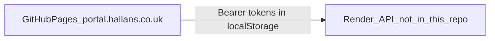

# Hallan portal audit

## Codebase profile

This repository is the public static portal for Hallan Cash & Carry, served from GitHub Pages at `portal.hallans.co.uk` ([CNAME](CNAME), remote `github.com/19999vahira/HallanList`). There is no `docs/` folder, README, package manifest, test suite, or CI. Every page is a self-contained HTML file. All persistent data is fetched from `https://hallan-picking-backend.onrender.com` (`http://localhost:3000` on localhost). That backend (`server.js`) is not in this workspace, so this audit can prescribe and inspect the client, and can only infer what the API must enforce.

What the pages do:

- [index.html](index.html) redirects to [home.html](home.html). The body copy still calls it the wholesale flyer and links to `/home/`, which does not exist.
- [home.html](home.html) is the public launcher: trade-account form on another GitHub Pages site, Staff Portal, Picking Sheets, Management, and Rota. Restaurant orders are marked “coming soon” here, but the feature already lives inside Picking Sheets.
- [staff-portal/index.html](staff-portal/index.html) is holiday self-service plus an HR admin (approve, partial approve, Excel upload). Login is Staff ID + password, then an emailed code. The role dropdown is not sent; the server returns `staff`, `manager`, or `hr`.
- [picking-sheets/index.html](picking-sheets/index.html) (~1.3 MB) is the warehouse SPA: picking, wholesale pricing, locations, stock, replenishment, suppliers, invoices, restaurant orders, WhatsApp, returns, labels, Shopify, damage logs, and a PDF library. Login is name + passcode, then email code, then an IP allow-list for admins. Tiles are hidden with `portalCan()` against `localStorage` role and modules.
- [management/index.html](management/index.html) is a separate shelf-check login. Any signed-in user can add users, zones, and locations, and can delete a zone together with its check history.
- [rota/index.html](rota/index.html) and [rota/schedule.html](rota/schedule.html) share the staff login API but store a different token. Schedule scope (HR / manager / staff) is applied in the browser from `localStorage`. [rota/clockin.html](rota/clockin.html) is a kiosk: it reuses a manager’s `rota_token`, downloads employees including PINs, and compares the PIN in the browser before writing a timesheet row.
- [timesheet/index.html](timesheet/index.html) is an unwired mock with fake hours.
- [veg-flyer.html](veg-flyer.html) and [wholesale-flyer.html](wholesale-flyer.html) (~4.4 MB) are public marketing pages. [pdf-library-admin-snippet.html](pdf-library-admin-snippet.html) uploads PDFs for public links but reads `portal_token`, not the session key the picking app actually stores.

Business-ending failure: a staff record, holiday balance, wholesale price, or timesheet punch exposed to the wrong person, or a password changed because someone knows an employee ID and department.



## Trust surfaces

Sensitive resource, then every path in this repo that reads or writes it:

- Staff identity, email, department, holiday balance: [staff-portal/index.html](staff-portal/index.html) (`/api/staff/login`, `verify`, `me`, `holiday-summary`, `leave-requests`, `holiday-employees`, `holiday-history`, `holiday-upload`); [rota/index.html](rota/index.html) (`signup`, `forgot-password`, `departments`); [rota/schedule.html](rota/schedule.html) (`rota-state`, `me`).
- Rota shifts, access grants, PINs: [rota/schedule.html](rota/schedule.html) loads and saves the whole rota; [rota/clockin.html](rota/clockin.html) reads employees and writes `timesheet-entry`.
- Wholesale prices and flyer assets: picking sheets (`wholesale/pricing`, `price-lock`, `price-changes`, `flyer/publish-webpage`, `flyer/pdfs`); public [wholesale-flyer.html](wholesale-flyer.html) and [veg-flyer.html](veg-flyer.html).
- Restaurant customers and orders: picking sheets passcode session (`hallan_restaurant_token`) plus a shared “Manage Customers” password.
- Management checks and manager accounts: [management/index.html](management/index.html) (`management/login`, `zones`, `locations`, `users`).
- Portal users, modules, allowed IPs: picking sheets (`portal/login`, `portal/users`, `portal/modules`, `portal/allowed-ips`).

## Pre-flight

Checked while reviewing this plan, on 13 November 2026:

- Repository root is `/Users/dcs/Herd/HallanList`. Local `user.email` is already `scott@dcsdigital.co.uk`. Do not change git config. If that address is different when execution starts, stop and ask.
- HEAD is `15f78bb`. The only untracked path is `.cursor/`. There is no `docs/`, no `package.json`, and no `docs/00-security.md`.
- Recent history messages are `Update index.html`, authored by someone else. This engagement still uses the conventional commit format below. Do not rewrite those old commits.

At the start of execution, run `git status` again. If an HTML page or the API host changed, update this plan before writing. Do not edit application HTML. Do not log in. Do not POST, PUT, PATCH, or DELETE against the live API. Do not commit `.cursor/`. A live observation, if done, is one unauthenticated GET of `https://portal.hallans.co.uk/` and its response headers. No credentials.

## Phase 0 — Documentation

Write prescriptive docs (what must stay true), not a tour of the current files. There is no existing `docs/` to preserve. Generate in this order, one file per commit:

- [docs/00-security.md](docs/00-security.md) first. Required headings, in order: a load-bearing banner; who is protected and the failure mode above; `## Trust boundaries`; `## Invariants`; `## What never happens`; `## GDPR / Privacy`; `## Part 2 — Rationale`. Trust boundaries to name: anonymous visitor, portal staff, portal admin, employee, manager, HR, management user, restaurant customer, kiosk device. Invariants the client and the API must both keep: the browser never chooses a role; module and department scope are enforced on the API, not by hiding a tile; passwords and PINs are checked on the server; a new password is not stored until the emailed code succeeds; `rota-state` must not return other people’s PINs; a kiosk must not run on a personal HR token; shared wholesale and restaurant passwords are a second server check on every sensitive read; no secrets in this git repo; public flyer PDFs contain no staff or customer data; deactivation and password change revoke every token family (`hallan_portal_session`, `hallanStaffToken`, `rota_token`, `hallan_mgmt_token`, `hallan_restaurant_token`). Part 2 explains the split logins, why department is a lookup key and not a secret, and why GitHub Pages is acceptable only while the HTML holds no data. State plainly that the API source is outside this repo and a front-end-only change is not a security fix. Done when every heading above is present and each named token key appears in the file.
- [docs/01-roles.md](docs/01-roles.md). Each role, who holds it, what the UI shows, and where the API must enforce it. Call out the staff-portal role `<select>` (not sent) and `rota_role` / `rota_login_id` (browser-writable).
- [docs/02-data-model.md](docs/02-data-model.md). A catalogue of client-visible resources and relationships inferred from the API calls. Label it as inferred. Do not invent column types for a database that is not here.
- [docs/03-environments.md](docs/03-environments.md). Production Pages versus localhost API switch, the Render host, what is shared (one production API, no staging visible), and how a page is published (git push to the GitHub repo).
- [docs/04-api.md](docs/04-api.md). The endpoints this front end calls, grouped by domain, with the auth header each one sends. Cite `00-security.md` for ownership rules. Mark rate limits and webhook verification as unknown until the backend is reviewed.
- [docs/05-architecture.md](docs/05-architecture.md). Request path for staff login, portal login, a wholesale price read, and a kiosk punch. Note that money and prices are expected to be computed on the server.

Later audit phases test findings against `00-security.md`. Accepted behaviour goes in residual risk, not as a High finding.

Before Phase 1, read [docs/00-security.md](docs/00-security.md) again. Cross-check every client write and every auth assumption against it. Flag a violation as a finding. If the doc already accepts the behaviour, record residual risk instead of a High finding.

Each later doc is done when it exists, uses British English, cites the pages it describes, and does not invent database column types, rate limits, or webhook checks.

## Testing

This engagement writes documentation and an audit report only. It does not change a security check, a data route, or any other application behaviour, so it adds no test file and no test runner. Phase 9 records the missing tests as a finding. A later remediation that changes auth or saved data must bring its own tests; that work is not part of this plan.

## Execution quality loop

There is no build, lint, or test script. Do not add one. After each task, before the commit:

- Re-read the file just written and confirm its required headings or finding fields are present.
- For `docs/00-security.md`, search the HTML for each token key named in the doc and confirm the doc matches the key the page actually uses.
- For a findings update, confirm each new entry has Severity, Location, Evidence, and Suggested fix, and that an absolute claim such as “every write is authorised” is backed by an enumerated list.
- Do not start the next task with a half-written file.

## Per-task commits

Before the first commit, confirm the root:

```bash
git -C /Users/dcs/Herd/HallanList rev-parse --show-toplevel
```

Commit from that root. Stage only the files for the task just finished. Never stage `.cursor/`, `.env`, or credential files.

After each task passes the quality loop, commit:

```
type(scope): short description

Body explaining what changed and why — not a list of files.
Focus on the reasoning: what problem does this solve, what
decision was made, what constraint does this respect.
```

Valid types: `feat`, `fix`, `chore`, `refactor`, `test`, `docs`. Use `docs` for this engagement. Scope is `security`, `roles`, `data-model`, `environments`, `api`, `architecture`, or `audit`. The body is required. Do not add a co-author or tooling attribution line. Do not carry a half-written file into the next task.

Commit boundaries: one commit per file in Phase 0; one commit after the security and privacy findings; one after accessibility, data, and bugs; one after performance, configuration, dependencies, testing, and code quality; one for the adversarial additions together with the finished report.

## Phase 1 — Security

Checklist: audit reference §1 (access control, injection and XSS, session, CSRF, mass assignment, redirects, rate limits, headers, secrets, commercial leakage, uploads). Files: [staff-portal/index.html](staff-portal/index.html), [picking-sheets/index.html](picking-sheets/index.html) (login, `portalCan`, wholesale auth, restaurant auth, PDF upload, WhatsApp IDs), [management/index.html](management/index.html), [rota/index.html](rota/index.html), [rota/schedule.html](rota/schedule.html) (`applyRoleNav`, `syncStateToServer`), [rota/clockin.html](rota/clockin.html), [pdf-library-admin-snippet.html](pdf-library-admin-snippet.html).

Enumerate every write (`fetch` POST/PUT/PATCH/DELETE) before claiming mass assignment or authorisation. Qualify anything that can only be true on the server. Highest-risk leads already visible: PIN comparison and full employee download in the kiosk; password-reset copy that says the password is saved before the code is entered; role and module checks that exist only in the browser; management user password input is `type="text"`; PDF list HTML interpolates filename and URL; staff token comments say the client never expires it.

## Phase 2 — Privacy

Checklist: audit reference §7. Personal data in holiday, rota, timesheet, restaurant customer, and management-user flows. What the static pages store in `localStorage`, what an Excel upload sends, and what a public flyer or PDF link can contain. No privacy notice is in the repo; record that as a process gap, not legal advice.

## Phase 3 — Accessibility

Checklist: audit reference §2, WCAG 2.2 AA. Pages with real UI: [home.html](home.html), staff portal, management, rota login and schedule, clock-in, picking sheets login and home tiles. Skip the generated flyer HTML except for a title, language, and image check. Triage any High as a compliance High, not a data-isolation blocker.

## Phase 4 — Data structures

Checklist: audit reference §3, limited to payloads this repo builds. Holiday upload column mapping and numeric parsing in the staff portal; rota state shape and client-side `uid()`; timesheet punch body; wholesale price fields sent from the browser. Do not grade database types, foreign keys, or migrations that are not in this repo. Record that absence as a methodology limit.

## Phase 5 — Bugs

Checklist: audit reference §4. Known suspects: [index.html](index.html) flyer copy and `/home/` link; [timesheet/index.html](timesheet/index.html) mock presented as a clock; PDF snippet token key `portal_token` versus `hallan_portal_session`; staff role control that does nothing; home page “coming soon” versus the live restaurant module; clock-in date via `toISOString()` (UTC) against UK-local times elsewhere.

## Phase 6 — Performance

Checklist: audit reference §5, focused on payload size. [wholesale-flyer.html](wholesale-flyer.html) (~4.4 MB), [picking-sheets/index.html](picking-sheets/index.html) (~1.3 MB, four CDN libraries), [rota/schedule.html](rota/schedule.html) (pdf.js). No build step or cache headers in-repo.

## Phase 7 — Configuration

Checklist: audit reference §8. Hard-coded API host repeated in each page, [CNAME](CNAME), no environment split for signing secrets, no deploy workflow. Confirm `.gitignore` is absent and that no `.env` is committed.

## Phase 8 — Dependencies

Checklist: audit reference §9. CDN scripts without a lockfile or subresource integrity: SheetJS, jsPDF, JsBarcode, pdf.js, Google Fonts, Facebook SDK loaded on demand (`WA_SIGNUP_APP_ID` is a public app id, not a secret). Note the comment that third-party scripts can read the page token.

## Phase 9 — Testing

Checklist: audit reference §6. There are no tests. The finding is the gap: no automated check that login, role routing, or a punch still works. Do not invent a test harness in this audit.

## Phase 10 — Code quality

Checklist: audit reference §10. Single-file apps far past 300 lines, duplicated API base and auth helpers, dead mock page, snippet that was never wired in. Inventory `TODO` / `FIXME` only if present.

## Phase 11 — Adversarial pass

Do not walk the checklists again. Three short investigations:

- Prices: every client field that can change a wholesale price, lock, margin, or restaurant order. Ask whether the API recomputes the figure the screen displays.
- Surfaces: for a staff employee and for a wholesale price row, list every load and save by ID in this repo and mark which ones carry only a bearer token plus an ID the browser chose.
- Ops and admin: public GitHub history, the kiosk token left on a shared device, management delete-with-history, the mock timesheet that looks live, and the PDF snippet that can publish a public URL.

Promote new issues. If `00-security.md` already accepts a behaviour, put it in residual risk.

## Phase 12 — Report

Write [docs/audit/2026-11-findings.md](docs/audit/2026-11-findings.md) during the phases (Severity, Location, Evidence, Suggested fix; IDs `SEC-`, `PRIV-`, `A11Y-`, `DATA-`, `BUG-`, `PERF-`, `CONF-`, `DEP-`, `TEST-`, `QUAL-`) and [docs/audit/2026-11-report.md](docs/audit/2026-11-report.md) at the end. Required sections: verdict, counts, methodology and limits (backend not reviewed; the only live check is the unauthenticated GET named in Pre-flight), Critical, High with fixes and a triage note on any WCAG High, Medium, Low, a “fix while live” gate, recommended order, residual risk citing `00-security.md`, open questions, glossary. Appendices: operations (kiosk re-login, who can create a manager, deploy is a git push) and assets (logo present at [assets/hallan-logo.png](assets/hallan-logo.png); flyer covers present).

Do not change application code. After the report, offer a separate plain-language brief for a non-technical reader. Do not write that brief unless asked.

## End-of-plan verification

After the report commit, re-read every plan item and confirm each one in the response: the six docs exist with the headings named above, the findings file and the report exist, no HTML file was modified, and `git status` shows only the intended docs commits plus the untracked `.cursor/` plan. Do not report a bare “done”.

## Knowledge capture

Use the `knowledge-memory` skill to capture this conversation — what was decided, why, and what was built — as a memory in the knowledge base. This is the last task, after verification.

## Out of scope

Search ranking and translation. The Render API’s real authorisation, hashing, rate limits, CORS, and database schema, except where this front end already reveals them. The external trade-account site linked from the home page.
