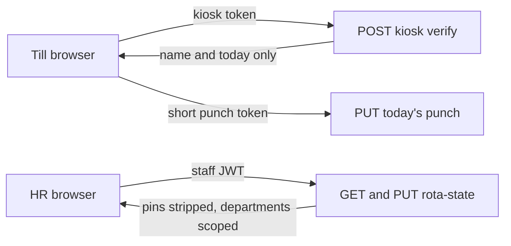

# High-severity audit fixes

The live gate in [docs/audit/2026-11-report.md](docs/audit/2026-11-report.md) is SEC-1, PRIV-2, SEC-2, SEC-3, SEC-4, ADV-1, and CONF-1. A11Y-1 is also High, and the report puts it after those. Medium findings (ADV-2, DATA-3, ADV-3, SEC-5, BUG-1) stay out of this slice.

The API is [hallan-picking-backend/server.js](/Users/dcs/Herd/hallan-picking-backend/server.js). [docs/00-security.md](docs/00-security.md) is load-bearing for tokens, PINs, and prices. Two git roots: `HallanList` and `hallan-picking-backend`. Do not push either remote unless asked.



## What the code actually does

- **SEC-1 / PRIV-2.** [rota/clockin.html](rota/clockin.html) loads `GET /api/staff/rota-state` and matches `loginId` and `pin` in the page. The schedule stores `pin` in the rota JSON and prefills it in a text field (`emp-pin`). `GET /api/staff/rota-state` returns that blob unchanged.
- **SEC-2.** The clock reuses `rota_token`. Every staff JWT, including the kiosk exception for employee id `2`, is signed for about ten years (`TOKEN_TTL` / `KIOSK_TOKEN_TTL`). The page comment that says twelve hours is stale.
- **SEC-3.** `POST /api/staff/forgot-password` already stores only `PENDING_PASSWORD_HASH` and applies it in `POST /api/staff/login/verify`. The staff page still says the password has been updated ([staff-portal/index.html](staff-portal/index.html) around the forgot-password success path). [rota/index.html](rota/index.html) shows "Password updated". Two leftovers in the same path: `POST /api/staff/login/resend-code` calls `beginStaffOtp` without the pending hash, so a resend deletes the reset; `POST /api/staff/signup` inserts `staff_auth` before the code. Invariant 8 forbids both.
- **SEC-4.** Role and department scope are applied in the browser from `rota_role` and `rota_login_id`. The API `PUT` replaces the whole `ROTA_STATE` blob for any staff token. `PUT /api/staff/timesheet-entry` writes any `employeeId` the body names. Grants are matched on the employee id typed at login (`accessGrants.*.loginId`).
- **ADV-1.** `POST /api/restaurant/order/submit` inserts `it.trade_price` as sent. Custom lines are inserted with a null price, which the XML export will emit as an empty `TradePrice`. Catalogue prices already come from `enrichWithWholesaleMeta`.
- **CONF-1.** Every page's `API_BASE` uses the live Render host unless the hostname is `localhost` or `127.0.0.1`. A Herd host or a file opened from disk calls production. There is no second API in this repo, so non-production hosts will call `http://localhost:3000` and any other hostname will refuse, rather than standing up a new Render service in this slice.
- **A11Y-1.** `loginName` / `loginPass` in [picking-sheets/index.html](picking-sheets/index.html) and `loginName` / `loginPassword` in [management/index.html](management/index.html) have placeholders and no labels.

## Deploy constraint

Filtering `GET /api/staff/rota-state` before the write path merges would let a scoped browser save a partial document and wipe other departments. Stripping `pin` before the schedule preserves a blank PIN would wipe every clock PIN. Ship pin-preserving merge and the kiosk routes first, switch the clock, pair the till, and only then strip pins and filter reads. The clock shows its existing setup step until the till holds a kiosk token. Clearing `rota_token` on that browser is required. Old JWTs stay valid until sign-out, because there is no server denylist (that is SEC-10, not this slice). Do not rotate `JWT_SECRET`.

## Pre-flight

Read [docs/00-security.md](docs/00-security.md) and cross-check every new token, rota write, and price write against invariants 1, 4, 8, 9, 10, and 11. In both repos, review commits and uncommitted changes since this plan. If they touch `server.js` staff routes, the clock, or `API_BASE`, update this plan before editing.

## 1. SEC-3 — password only after the code

In [server.js](/Users/dcs/Herd/hallan-picking-backend/server.js):

- `resend-code` must copy `PENDING_PASSWORD_HASH` from the current OTP row into the new one. A resend must not drop a reset that has not been confirmed.
- Signup must hash the password into `PENDING_PASSWORD_HASH` and insert `staff_auth` only inside the verify branch that already applies a pending hash. If the email fails, no password row is created.

In [staff-portal/index.html](staff-portal/index.html) and [rota/index.html](rota/index.html), the success copy says a code has been emailed and the new password is saved only after that code is accepted. Remove the rota comment that says the backend logs them straight in.

Done when: a forgot-password or signup request leaves `staff_auth.password_hash` unchanged until verify; a resend still applies that hash; both pages no longer say the password is already saved.

## 2. SEC-1, PRIV-2, SEC-2 — kiosk routes, clock still on the old read

Add routes that do not accept a normal staff JWT:

- `POST /api/staff/kiosk/pair`, HR only. Returns a JWT `{ type: 'kiosk' }` stored as `hallan_kiosk_token`. It cannot call `rota-state` or `timesheet-state`.
- `POST /api/staff/kiosk/revoke`, HR only, invalidates pairing by a `kioskVersion` claim checked on each kiosk call. This is how the till credential is withdrawn without rotating `JWT_SECRET`.
- `POST /api/staff/kiosk/verify` with the kiosk token and `{ loginId, pin }`. Looks up the employee in `ROTA_STATE`, compares the PIN (bcrypt, and a one-time upgrade if the stored value is still the old plaintext), and returns only that person's name, department, rota employee id, and today's punches. Today is `Europe/London`, not the browser's UTC date. Also returns a punch JWT `{ type: 'punch', employeeId, date }` of a few minutes.
- `PUT /api/staff/kiosk/punch` accepts only that punch token, only that employee, only that London date, and only the punch fields.

Add `hallan_kiosk_token` to invariant 13 in [docs/00-security.md](docs/00-security.md). Leave `GET /api/staff/rota-state` unchanged in this step so the current clock keeps working until the next frontend deploy.

On [rota/clockin.html](rota/clockin.html): stop reading `rota_token`, `rota-state`, and `timesheet-state`. Call verify and punch. Setup copy tells an HR user to pair the device, then removes `rota_token`, `rota_role`, and `rota_login_id` from that browser. On [rota/schedule.html](rota/schedule.html), the HR-only clock nav gets a Pair this till action that calls the pair route.

Done when: the clock never downloads the employee list; a staff or manager JWT receives 403 on the kiosk routes; a kiosk JWT receives 403 on `rota-state`.

## 3. SEC-1, PRIV-2, SEC-4 — strip PINs and scope the blob

Extract pure helpers (no Oracle) so they can be tested without booting `server.js`:

- Scope: HR sees every department. A manager's departments come from `accessGrants.managers` where `loginId` equals the JWT `employeeId`. A staff editor's departments come from `accessGrants.editors` the same way. No grant means no departments. Never read `rota_role`.
- `GET /api/staff/rota-state` returns only in-scope employees, their shifts, and their time off, and deletes `pin` on every employee. Managers do not receive `accessGrants`.
- `PUT /api/staff/rota-state` keeps optimistic locking. HR may replace the document. A blank or omitted `pin` keeps the stored PIN; a new PIN is hashed. A manager PUT is rejected. A staff editor may change `shifts` and `timeOff` only for in-scope employees; any other difference, including a missing out-of-scope employee, is 403 and must not delete stored rows.
- `GET /api/staff/timesheet-state` and `PUT /api/staff/timesheet-entry` use the same department scope. The kiosk does not use these routes.

On the schedule, stop prefilling `emp-pin`. The field becomes `type="password"` with placeholder text that a blank value keeps the current PIN. The employees table no longer prints the PIN. The page may still hide tabs from `rota_role` for display; the API result is the authority.

Stop issuing the ten-year exception for employee id `2` on new logins (`KIOSK_EMPLOYEE_IDS`). Do not treat that account as the device credential.

Done when: a non-HR token cannot read another department's employees, shifts, time off, or punches, and cannot PUT them; no response body contains `pin`; saving the schedule after a filtered load does not remove other departments or clear PINs.

## 4. ADV-1 — server prices the order

In `POST /api/restaurant/order/submit`, ignore `trade_price` from the body. For each line with a `stockid`, set the price from the same wholesale price query `enrichWithWholesaleMeta` already uses. An unknown stock id is rejected. A line with no stock id is stored with `TRADE_PRICE` null and is not written as zero. The response lists each line with the stored price and `unpriced: true` for custom or unpriced catalogue lines. [picking-sheets/index.html](picking-sheets/index.html) builds the confirmation PDF from that response, so a tampered cart price is not what the customer is shown.

Done when: a body that sends `trade_price: 0` for a real stock id stores the wholesale price, and a custom line is stored as null rather than zero.

## 5. CONF-1 — only the live hostname calls production

In each `API_BASE` (picking, staff portal, management, rota login, schedule, clock, and the PDF snippet): call `https://hallan-picking-backend.onrender.com` only when `location.hostname === 'portal.hallans.co.uk'`. `localhost` and `127.0.0.1` call `http://localhost:3000`. Any other hostname, including a Herd `*.test` name or a `file://` page, does not call Render. Show a short on-page error instead of sending the request.

Done when: searching the HTML shows the Render host only inside that hostname check, and opening a non-production host does not request `onrender.com`.

## 6. A11Y-1 — labels on the two sign-in forms

Add visible `<label for>` pairs, matching the staff portal, for picking `loginName` and `loginPass`, and management `loginName` and `loginPassword`. Keep the placeholders as examples.

Done when: each of those four inputs has a label whose `for` matches its `id`.

## Tests and quality loop

There is no test runner today. Add Node's built-in test runner and `npm test` (`node --test`). New tests live next to the extracted helpers and do not connect to Oracle:

- Rota scope: HR keeps every department; a manager and an editor receive only granted departments; a staff token with no grant receives none; `pin` is absent from the filtered document.
- Rota merge: an editor can change an in-scope shift; an out-of-scope employee missing from the body is still in the merged document; a PIN omitted by the client is kept; a new PIN is stored as a bcrypt hash.
- Kiosk rules: punch token for employee A cannot write employee B or another date; a staff JWT is not a kiosk token.
- Order pricing: client `trade_price` is discarded; a known stock id gets the server price; a custom line stays null, not 0.
- Password pending: the resend helper keeps `PENDING_PASSWORD_HASH`; signup does not produce a `staff_auth` write before verify (test the decision function, not a live Oracle call).

After each task: `node --check server.js` and `npm test` in the backend when that repo changed; in the frontend, grep for the old pattern (client PIN compare, "password has been updated", Render host outside the hostname guard, sign-in inputs with no label). Re-read the diff against invariants 8, 9, 10, and 11.

Browser check, on a local or Herd URL only: forgot-password copy, clock setup without a kiosk token, schedule PIN field not showing a stored PIN, picking and management sign-in labels, and the network panel showing no request to `onrender.com`. Do not pair the live till or submit a live restaurant order as part of this check.

## Commits

Before the first commit in each repo, `git rev-parse --show-toplevel` from a changed file and commit from that root. One commit per task above, after its quality loop passes. Backend and frontend changes that belong to the same task are two commits, one in each repo. Format:

```
fix(scope): short description

Why this change is safe, and which finding it closes.
```

Types: `fix` for the findings, `test` for the new runner if it lands alone, `docs` for the security-model token line. No co-author trailer. Do not commit `.env` or wallet material.

## Finish

Run `npm test` once more. Walk the seven findings and A11Y-1 and state, for each, the route or page that now enforces it. Then use the knowledge-memory skill to record what was decided, why the till uses a separate credential, and the deploy order (kiosk and pin-preserving writes first, pin stripping and department filter only after the till is paired).
