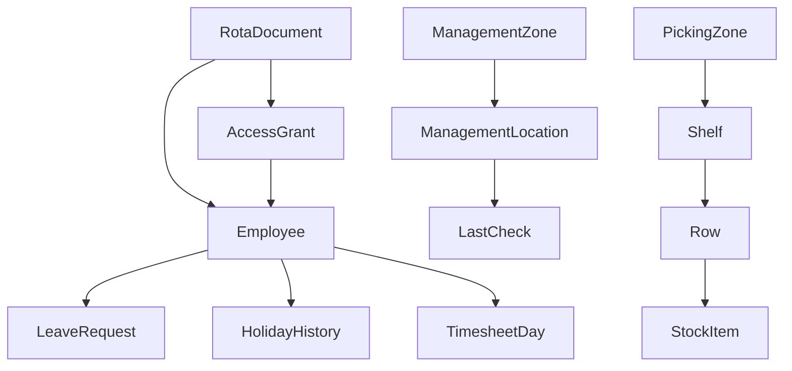

# Data model

This is a catalogue of resources the pages send and receive. It is inferred from the HTML in this repository. It is not a database schema. Column types, nullability, foreign keys, and migrations live in the API, which is not here. Do not invent them from this file.

Nothing in this repository is soft-deleted. The pages call `DELETE` and the user is told the history goes with the row. Whether the API cascades is unknown.

Money figures for wholesale prices are sent as JSON numbers or strings from the browser. The API must store and re-check them as decimals. This page cannot see the column type.

## Resources

| Resource | Purpose | Fields the pages actually use |
| --- | --- | --- |
| Portal user | Picking-app login | `user_id`, `name`, `email`, `role` (`admin` or `staff`), `modules` (list of keys), `active`, `passcode` on create |
| Portal module | A tile the user may open | `key`, `label`. Known keys on the home tiles: `picking`, `wholesale`, `location`, `stockinfo`, `replenishment`, `supplier`, `invoices`, `restaurant`, `whatsapp`, `returns`, `labels` |
| Allowed IP | Extra gate for portal admins | `ip_address`, `label` |
| Employee | Holiday and rota person | `employee_id` or rota `id`, `full_name` / `name`, `department`, `email`, `position`, `holiday_allocation`, `holiday_taken`, `holiday_balance`, `weekly_working_days`, rota `loginId`, `pin`, `personnelNumber`, `shiftTypeIds`, `hidden` |
| Leave request | A holiday booking awaiting a decision | `request_id`, `employee_id`, `full_name`, `department`, `start_date`, `end_date`, `days_requested`, `reason`, `status` (`pending`, `approved`, `declined`, `partial`), `partial_days`, `decision_note`, `created_at`, plus the employee's holiday figures on the HR row |
| Holiday history | Past leave, from a request or a spreadsheet | `start_date`, `end_date`, `days`, `type`, `note`, `source` (`upload` or a request) |
| Rota document | One JSON blob for the whole shop | `shiftTypes`, `employees`, `shifts` (by employee, then date, then a list of shifts), `timeOff`, `accessGrants.editors`, `accessGrants.managers`, plus `updatedAt` for conflict checks |
| Shift | One span on one day | `id`, `shiftTypeId`, `start`, `end`, `breakMins` |
| Time off | Week off or annual leave drawn on the rota | `id`, `employeeId`, `from`, `to`, `type` (`weekoff` or `annual`), `reason` |
| Access grant | Who may edit or view a department | `id`, `name`, `loginId`, `departments` |
| Timesheet day | Clock punches for one employee on one date | `employeeId`, `date`, `in`, `breakStart`, `breakEnd`, `out`, `comment` |
| Management zone | A shelf-check area | `zone_id`, `zone_name`, `location_count` |
| Management location | A point to tick on a walk | `location_id`, `location_name`, `last_checked_at`, `last_checked_by` |
| Management user | Shelf-check login | `name`, `created_at`, password on create only |
| Picking location | Where stock sits for picking. Separate from shelf-check | Zone, shelf, row, then an item row (`item_row_id`) linked to a stock search result |
| Wholesale price row | A selling price the flyer and the pricing screen use | `stock_name`, `price`, `margin`, and a lock snapshot of those three. Cost is described as always live and not part of the lock |
| Price-change log | An audit line after an edit | Sent from the page to `wholesale/price-changes/log`. Exact stored columns are not visible here |
| Flyer asset | Image slot or public PDF | `slot_key` or `filename`, image data or `pdf_base64`, public `url` |
| Restaurant customer | A buyer with a passcode | `customer_id`, `customer_name`, `passcode` |
| Damage log | Warehouse damage, with photos | Quantity, reason, location, images |
| WhatsApp list and contact | Broadcast audience | List `name`. Contact `name`, `phone`, `list_id` |

## Relationships the pages assume

Shelf-check zones and picking zones are different APIs (`/api/management/zones/` and `/api/location/zones/`). Do not merge them.

The rota is one document, not a row per shift. A save sends `{ data, expectedUpdatedAt }`. A `409` means someone else saved, and the page reloads. Client-side ids are `emp_…`, `acc_…`, and similar random strings from `uid()`. They are not database sequences.

Holiday upload rows are parsed in the browser and posted as JSON. Employee rows need a staff ID. History rows need a staff ID and a start date. Creating missing employees is a checkbox, default on. Replacing history is a checkbox, default off.

## What this file will not say

It will not name SQL types, indexes, or `ON DELETE` behaviour. Those need the API repository. It will not claim a soft-delete column. The pages do not send one.
