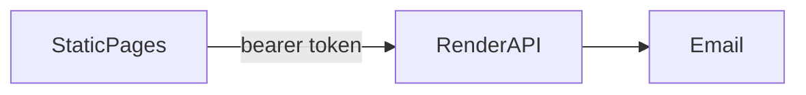

# Architecture

The browser is a set of HTML files on GitHub Pages. The API on Render is the system of record. A happy path below is what must happen. Where today's page does something weaker, [00-security.md](00-security.md) wins.

## Staff login

1. [rota/index.html](../rota/index.html) or [staff-portal/index.html](../staff-portal/index.html) posts Staff ID and password to `POST /api/staff/login`. The role dropdown is not part of that body.
2. The API checks the password hash and emails a code. The response has no token.
3. The page posts the code to `POST /api/staff/login/verify`.
4. The API returns a token, the employee, and the role it derived.
5. The staff portal stores `hallanStaffToken` and opens either the personal holiday page or the HR admin. The rota stores `rota_token` and opens the schedule.
6. Later reads send the bearer token. The API scopes the row. The copy of the role in `localStorage` is for rendering only.

Signup and forgotten password use the same code step. The new password is stored only when the code succeeds.

## Portal login

1. [picking-sheets/index.html](../picking-sheets/index.html) posts name and passcode to `POST /api/portal/login`.
2. The API emails a code and returns no token.
3. `POST /api/portal/login/verify` returns the token, role, modules, and whether the IP is allowed.
4. The page stores `hallan_portal_session` and hides tiles the module list does not include.
5. Every later `apiGet` / `apiPost` sends the bearer token. A `401` with `portalAuthRequired` signs the page out. A `403` with `ipNotAllowed` blocks the session. An admin may add the current IP. Anyone else is stopped.

## A wholesale price

1. The caller already holds a portal token, and the API has granted the `wholesale` module.
2. The page asks for the shared pricing password. `POST /api/wholesale/auth/verify` must succeed on the server before prices are returned.
3. `GET /api/wholesale/pricing/` returns the rows. The page may recompute a margin locally for display.
4. A block posts the on-screen price and margin to `POST /api/wholesale/price-lock/block`. That payload is a request. The API stores the decimal it accepts and is the figure a later flyer or order must use.
5. Publishing a webpage or a PDF reads those stored figures. It does not trust a second copy hidden in the HTML file.

Cost is described in the page as always live, even while selling prices are locked. The API should keep that split: a lock freezes the selling price, not the cost feed.

## A kiosk punch

What must happen:

1. The device holds a clock credential, not a person's rota token.
2. The employee types Login ID and PIN. The page sends them to the API.
3. The API checks the PIN and returns that person's name and today's punches. It does not return anyone else's PIN.
4. Clock in, break, or clock out sends `PUT /api/staff/timesheet-entry` for that person and today's date only.
5. The screen clears after a few seconds so the next person starts from the login step.

What the page does today is different, and it is not the model to copy. [rota/clockin.html](../rota/clockin.html) reads `rota_token`, downloads `rota-state`, compares `pin` in the browser, and writes the timesheet with the device's token and a client-chosen employee id. Change the API and the page together. Do not keep the browser comparison because it already works on one till.

## Other integration points

Email is how login codes leave the building. The pages assume it arrives. They cannot send mail themselves.

PDFs are built in the browser with jsPDF for some prints, and published through the API for the public flyer library. A browser PDF is only as confidential as the screen it came from.

WhatsApp sends go through `POST /api/whatsapp/send` and the embedded-signup exchange. The app secret stays on the API.

There is no payment capture in these pages. Prices are catalogue and flyer figures, not card charges.
